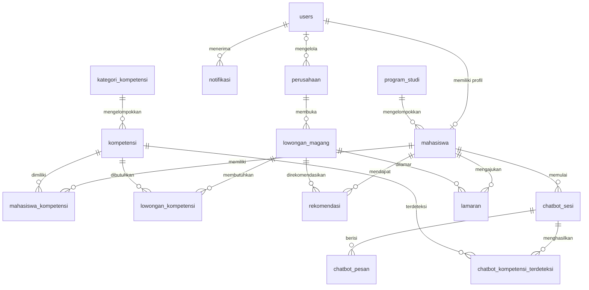

# 05 - Database `db_magang`

Dokumen ini menggabungkan rancangan database pada PRD dengan **Laporan Praktikum Skema Database** (Nabilla Ramadhani dan Nur Aziza, MI 5C, 08 September 2026; sumber `skema_database.md` v1.0). **Skema pada laporan menjadi acuan utama**; bagian PRD yang berbeda (misalnya tabel `students`, `positions`, `interests`) digantikan oleh dokumen ini.

## 1. Ringkasan

| Item                | Nilai                                                                                |
| ------------------- | ------------------------------------------------------------------------------------ |
| Nama database       | `db_magang`                                                                          |
| DBMS target         | MySQL 8.0+ atau MariaDB 10.6+ (belum diuji eksekusi pada laporan)                    |
| Storage engine      | InnoDB                                                                               |
| Karakter dan kolasi | `utf8mb4`, `utf8mb4_unicode_ci`                                                      |
| Jumlah struktur     | 15 tabel, 119 kolom, 18 foreign key                                                  |
| Peran pengguna      | `admin`, `mahasiswa`, `dosen`, `perusahaan`                                          |
| Cakupan proses      | Autentikasi, profil, kompetensi, lowongan, rekomendasi, chatbot, lamaran, notifikasi |

**Konvensi umum:** setiap tabel memakai `id INT NOT NULL AUTO_INCREMENT` sebagai primary key; semua FK memakai `ON UPDATE CASCADE`; "waktu kini" berarti `CURRENT_TIMESTAMP`; "otomatis diperbarui" berarti `ON UPDATE CURRENT_TIMESTAMP`.

## 2. Daftar Tabel

| No  | Tabel                           | Modul       | Fungsi                                             |
| --- | ------------------------------- | ----------- | -------------------------------------------------- |
| 1   | `users`                         | Autentikasi | Akun login semua pengguna                          |
| 2   | `program_studi`                 | Akademik    | Master program studi dan jurusan                   |
| 3   | `mahasiswa`                     | Mahasiswa   | Profil lengkap mahasiswa                           |
| 4   | `kategori_kompetensi`           | Kompetensi  | Kelompok kompetensi                                |
| 5   | `kompetensi`                    | Kompetensi  | Master semua kompetensi                            |
| 6   | `mahasiswa_kompetensi`          | Kompetensi  | Kompetensi yang dimiliki tiap mahasiswa            |
| 7   | `perusahaan`                    | Perusahaan  | Perusahaan atau instansi penyedia magang           |
| 8   | `lowongan_magang`               | Lowongan    | Posisi magang yang dibuka                          |
| 9   | `lowongan_kompetensi`           | Lowongan    | Kompetensi yang dibutuhkan tiap lowongan           |
| 10  | `rekomendasi`                   | Rekomendasi | Hasil rekomendasi berdasarkan kecocokan kompetensi |
| 11  | `chatbot_sesi`                  | Chatbot     | Sesi percakapan pemetaan kompetensi                |
| 12  | `chatbot_pesan`                 | Chatbot     | Log pesan dalam sesi                               |
| 13  | `chatbot_kompetensi_terdeteksi` | Chatbot     | Kompetensi hasil deteksi chatbot                   |
| 14  | `lamaran`                       | Lamaran     | Pengajuan lamaran magang                           |
| 15  | `notifikasi`                    | Notifikasi  | Pemberitahuan untuk pengguna                       |

## 3. Kamus Data

Kolom "NULL": Tidak = wajib diisi, Ya = boleh kosong. PK = primary key, FK = foreign key, UK = unique key.

### 3.1. `users`

Tabel pusat autentikasi. Satu email hanya untuk satu akun; kewenangan rinci per peran diatur di aplikasi.

| Kolom      | Tipe                                           | NULL  | Kunci / Default / Keterangan            |
| ---------- | ---------------------------------------------- | ----- | --------------------------------------- |
| id         | INT                                            | Tidak | PK; AUTO_INCREMENT                      |
| email      | VARCHAR(150)                                   | Tidak | UK                                      |
| password   | VARCHAR(255)                                   | Tidak | Hash bcrypt                             |
| role       | ENUM('admin','mahasiswa','dosen','perusahaan') | Tidak | Default `'mahasiswa'`                   |
| is_active  | TINYINT(1)                                     | Tidak | Default 1                               |
| created_at | TIMESTAMP                                      | Tidak | Default waktu kini                      |
| updated_at | TIMESTAMP                                      | Tidak | Default waktu kini; otomatis diperbarui |

Unik: (email). Indeks: (role).

### 3.2. `program_studi`

| Kolom      | Tipe                 | NULL  | Kunci / Default / Keterangan |
| ---------- | -------------------- | ----- | ---------------------------- |
| id         | INT                  | Tidak | PK; AUTO_INCREMENT           |
| kode_prodi | VARCHAR(10)          | Tidak | UK                           |
| nama_prodi | VARCHAR(100)         | Tidak | -                            |
| fakultas   | VARCHAR(100)         | Tidak | -                            |
| jenjang    | ENUM('D3','S1','S2') | Tidak | Default `'S1'`               |

### 3.3. `mahasiswa`

Profil dipisahkan dari akun login; UNIQUE pada `user_id` membatasi satu akun maksimal satu profil.

| Kolom        | Tipe         | NULL  | Kunci / Default / Keterangan            |
| ------------ | ------------ | ----- | --------------------------------------- |
| id           | INT          | Tidak | PK; AUTO_INCREMENT                      |
| user_id      | INT          | Tidak | UK; FK → users.id                       |
| prodi_id     | INT          | Tidak | FK → program_studi.id                   |
| nim          | VARCHAR(20)  | Tidak | UK                                      |
| nama_lengkap | VARCHAR(150) | Tidak | -                                       |
| semester     | TINYINT      | Tidak | Default 1                               |
| ipk          | DECIMAL(3,2) | Tidak | Default 0.00                            |
| foto         | VARCHAR(255) | Ya    | Path relatif foto profil                |
| no_telp      | VARCHAR(20)  | Ya    | -                                       |
| alamat       | TEXT         | Ya    | -                                       |
| cv_path      | VARCHAR(255) | Ya    | Path file CV                            |
| porto_url    | VARCHAR(255) | Ya    | URL portofolio / GitHub                 |
| created_at   | TIMESTAMP    | Tidak | Default waktu kini                      |
| updated_at   | TIMESTAMP    | Tidak | Default waktu kini; otomatis diperbarui |

Unik: (nim), (user_id). Indeks: (prodi_id). Hapus: user_id → CASCADE; prodi_id → RESTRICT.

### 3.4. `kategori_kompetensi`

| Kolom         | Tipe         | NULL  | Kunci / Default / Keterangan |
| ------------- | ------------ | ----- | ---------------------------- |
| id            | INT          | Tidak | PK; AUTO_INCREMENT           |
| nama_kategori | VARCHAR(100) | Tidak | UK                           |
| deskripsi     | TEXT         | Ya    | -                            |

### 3.5. `kompetensi`

Dipakai bersama oleh profil mahasiswa, kebutuhan lowongan, dan hasil deteksi chatbot.

| Kolom           | Tipe         | NULL  | Kunci / Default / Keterangan |
| --------------- | ------------ | ----- | ---------------------------- |
| id              | INT          | Tidak | PK; AUTO_INCREMENT           |
| kategori_id     | INT          | Tidak | FK → kategori_kompetensi.id  |
| nama_kompetensi | VARCHAR(100) | Tidak | UK                           |
| deskripsi       | TEXT         | Ya    | -                            |
| icon            | VARCHAR(100) | Ya    | Nama ikon atau class CSS     |

Indeks: (kategori_id). Hapus: kategori_id → RESTRICT.

### 3.6. `mahasiswa_kompetensi`

| Kolom         | Tipe                              | NULL  | Kunci / Default / Keterangan |
| ------------- | --------------------------------- | ----- | ---------------------------- |
| id            | INT                               | Tidak | PK; AUTO_INCREMENT           |
| mahasiswa_id  | INT                               | Tidak | FK → mahasiswa.id            |
| kompetensi_id | INT                               | Tidak | FK → kompetensi.id           |
| level         | ENUM('pemula','menengah','mahir') | Tidak | Default `'pemula'`           |
| sumber        | ENUM('manual','chatbot','import') | Tidak | Default `'manual'`           |
| bukti_url     | VARCHAR(255)                      | Ya    | URL sertifikat, proyek, dsb  |
| created_at    | TIMESTAMP                         | Tidak | Default waktu kini           |

Unik: (mahasiswa_id, kompetensi_id). Indeks: (kompetensi_id). Hapus: mahasiswa_id → CASCADE; kompetensi_id → RESTRICT.

> **Catatan keterbatasan:** Tabel ini tidak memiliki kolom `updated_at`. Bila level kompetensi diperbarui (misalnya oleh chatbot), tidak ada cara mudah mengetahui kapan pembaruan terjadi. Pertimbangkan menambahkan `updated_at` lewat migrasi jika audit trail diperlukan (lihat bagian 9).

### 3.7. `perusahaan`

`user_id` boleh NULL bila data diinput langsung oleh admin. DDL belum memberi UNIQUE pada `user_id`.

| Kolom           | Tipe         | NULL  | Kunci / Default / Keterangan            |
| --------------- | ------------ | ----- | --------------------------------------- |
| id              | INT          | Tidak | PK; AUTO_INCREMENT                      |
| user_id         | INT          | Ya    | FK → users.id; default NULL             |
| nama_perusahaan | VARCHAR(150) | Tidak | -                                       |
| bidang_usaha    | VARCHAR(100) | Ya    | -                                       |
| deskripsi       | TEXT         | Ya    | -                                       |
| alamat          | TEXT         | Ya    | -                                       |
| kota            | VARCHAR(100) | Ya    | -                                       |
| provinsi        | VARCHAR(100) | Ya    | -                                       |
| website         | VARCHAR(255) | Ya    | -                                       |
| logo            | VARCHAR(255) | Ya    | -                                       |
| email_kontak    | VARCHAR(150) | Ya    | -                                       |
| no_telp         | VARCHAR(20)  | Ya    | -                                       |
| verified        | TINYINT(1)   | Tidak | Default 0; 1 = sudah diverifikasi admin |
| created_at      | TIMESTAMP    | Tidak | Default waktu kini                      |
| updated_at      | TIMESTAMP    | Tidak | Default waktu kini; otomatis diperbarui |

Indeks: (kota), (verified). Hapus: user_id → SET NULL.

### 3.8. `lowongan_magang`

| Kolom         | Tipe                            | NULL  | Kunci / Default / Keterangan            |
| ------------- | ------------------------------- | ----- | --------------------------------------- |
| id            | INT                             | Tidak | PK; AUTO_INCREMENT                      |
| perusahaan_id | INT                             | Tidak | FK → perusahaan.id                      |
| judul_posisi  | VARCHAR(150)                    | Tidak | -                                       |
| deskripsi     | TEXT                            | Ya    | -                                       |
| kuota         | INT                             | Tidak | Default 1                               |
| durasi_bulan  | TINYINT                         | Tidak | Default 3                               |
| tgl_buka      | DATE                            | Tidak | -                                       |
| tgl_tutup     | DATE                            | Tidak | -                                       |
| min_semester  | TINYINT                         | Ya    | -                                       |
| min_ipk       | DECIMAL(3,2)                    | Ya    | -                                       |
| is_remote     | TINYINT(1)                      | Tidak | Default 0                               |
| status        | ENUM('draft','aktif','ditutup') | Tidak | Default `'draft'`                       |
| created_at    | TIMESTAMP                       | Tidak | Default waktu kini                      |
| updated_at    | TIMESTAMP                       | Tidak | Default waktu kini; otomatis diperbarui |

Indeks: (perusahaan_id), (status), (tgl_tutup). Hapus: perusahaan_id → CASCADE.

### 3.9. `lowongan_kompetensi`

| Kolom         | Tipe         | NULL  | Kunci / Default / Keterangan            |
| ------------- | ------------ | ----- | --------------------------------------- |
| id            | INT          | Tidak | PK; AUTO_INCREMENT                      |
| lowongan_id   | INT          | Tidak | FK → lowongan_magang.id                 |
| kompetensi_id | INT          | Tidak | FK → kompetensi.id                      |
| bobot         | DECIMAL(3,2) | Tidak | Default 1.00; bobot kepentingan 0.0-1.0 |
| wajib         | TINYINT(1)   | Tidak | Default 0; 1 = wajib dimiliki           |

Unik: (lowongan_id, kompetensi_id). Indeks: (kompetensi_id). Hapus: lowongan_id → CASCADE; kompetensi_id → RESTRICT.

### 3.10. `rekomendasi`

Pasangan mahasiswa-lowongan belum dibatasi unik (memungkinkan riwayat).

| Kolom              | Tipe         | NULL  | Kunci / Default / Keterangan                                           |
| ------------------ | ------------ | ----- | ---------------------------------------------------------------------- |
| id                 | INT          | Tidak | PK; AUTO_INCREMENT                                                     |
| mahasiswa_id       | INT          | Tidak | FK → mahasiswa.id                                                      |
| lowongan_id        | INT          | Tidak | FK → lowongan_magang.id                                                |
| skor_kecocokan     | DECIMAL(5,2) | Tidak | Default 0.00; rentang 0.00-100.00                                      |
| metode             | VARCHAR(50)  | Tidak | Default `'cosine_similarity'`; pilihan: SAW, TOPSIS, cosine_similarity |
| detail_perhitungan | JSON         | Ya    | Rincian perhitungan per kompetensi                                     |
| generated_at       | TIMESTAMP    | Tidak | Default waktu kini                                                     |

Indeks: (mahasiswa_id), (lowongan_id), (skor_kecocokan DESC), (generated_at). Hapus: mahasiswa_id, lowongan_id → CASCADE.

> **Penting:** DDL menggunakan `DEFAULT 'cosine_similarity'` pada kolom `metode`, tetapi implementasi MVP memakai metode `'SAW'`. Aplikasi **selalu mengisi kolom ini secara eksplisit** (`metode = 'SAW'`), sehingga nilai DEFAULT tidak akan aktif di jalur normal. Untuk menghindari kebingungan, ubah DEFAULT lewat migrasi (lihat bagian 9).

### 3.11. `chatbot_sesi`

| Kolom        | Tipe                                 | NULL  | Kunci / Default / Keterangan |
| ------------ | ------------------------------------ | ----- | ---------------------------- |
| id           | INT                                  | Tidak | PK; AUTO_INCREMENT           |
| mahasiswa_id | INT                                  | Tidak | FK → mahasiswa.id            |
| judul_sesi   | VARCHAR(150)                         | Ya    | -                            |
| status       | ENUM('aktif','selesai','dibatalkan') | Tidak | Default `'aktif'`            |
| started_at   | TIMESTAMP                            | Tidak | Default waktu kini           |
| ended_at     | TIMESTAMP                            | Ya    | -                            |

Indeks: (mahasiswa_id), (status). Hapus: mahasiswa_id → CASCADE.

### 3.12. `chatbot_pesan`

| Kolom      | Tipe               | NULL  | Kunci / Default / Keterangan |
| ---------- | ------------------ | ----- | ---------------------------- |
| id         | INT                | Tidak | PK; AUTO_INCREMENT           |
| sesi_id    | INT                | Tidak | FK → chatbot_sesi.id         |
| peran      | ENUM('user','bot') | Tidak | -                            |
| isi_pesan  | TEXT               | Tidak | -                            |
| intent     | VARCHAR(100)       | Ya    | Intent yang terdeteksi       |
| entitas    | JSON               | Ya    | `{skill, level, confidence}` |
| created_at | TIMESTAMP          | Tidak | Default waktu kini           |

Indeks: (sesi_id), (created_at). Hapus: sesi_id → CASCADE.

### 3.13. `chatbot_kompetensi_terdeteksi`

Penampung hasil deteksi chatbot sebelum dan sesudah konfirmasi. Pemindahan ke profil dilakukan oleh aplikasi (tidak ada trigger).

| Kolom         | Tipe                              | NULL  | Kunci / Default / Keterangan                |
| ------------- | --------------------------------- | ----- | ------------------------------------------- |
| id            | INT                               | Tidak | PK; AUTO_INCREMENT                          |
| sesi_id       | INT                               | Tidak | FK → chatbot_sesi.id                        |
| kompetensi_id | INT                               | Tidak | FK → kompetensi.id                          |
| level         | ENUM('pemula','menengah','mahir') | Tidak | Default `'pemula'`                          |
| confidence    | DECIMAL(4,3)                      | Tidak | Default 0.000; rentang 0.000-1.000          |
| dikonfirmasi  | TINYINT(1)                        | Tidak | Default 0; 1 = sudah dikonfirmasi mahasiswa |
| created_at    | TIMESTAMP                         | Tidak | Default waktu kini                          |

Indeks: (sesi_id), (kompetensi_id). Hapus: sesi_id → CASCADE; kompetensi_id → RESTRICT.

> **Catatan keterbatasan:** Tidak ada kolom `updated_at`, sehingga waktu konfirmasi tidak tercatat di database. Untuk keperluan audit, pertimbangkan menambahkan kolom ini lewat migrasi.

### 3.14. `lamaran`

| Kolom              | Tipe                                               | NULL  | Kunci / Default / Keterangan                   |
| ------------------ | -------------------------------------------------- | ----- | ---------------------------------------------- |
| id                 | INT                                                | Tidak | PK; AUTO_INCREMENT                             |
| mahasiswa_id       | INT                                                | Tidak | FK → mahasiswa.id                              |
| lowongan_id        | INT                                                | Tidak | FK → lowongan_magang.id                        |
| sumber_rekomendasi | TINYINT(1)                                         | Tidak | Default 0; 1 = berasal dari rekomendasi sistem |
| surat_pengantar    | TEXT                                               | Ya    | -                                              |
| status             | ENUM('menunggu','diterima','ditolak','dibatalkan') | Tidak | Default `'menunggu'`                           |
| tgl_lamar          | TIMESTAMP                                          | Tidak | Default waktu kini                             |
| tgl_respons        | TIMESTAMP                                          | Ya    | -                                              |
| catatan_perusahaan | TEXT                                               | Ya    | -                                              |

Unik: (mahasiswa_id, lowongan_id). Indeks: (lowongan_id), (status). Hapus: mahasiswa_id, lowongan_id → CASCADE.

### 3.15. `notifikasi`

| Kolom        | Tipe         | NULL  | Kunci / Default / Keterangan      |
| ------------ | ------------ | ----- | --------------------------------- |
| id           | INT          | Tidak | PK; AUTO_INCREMENT                |
| user_id      | INT          | Tidak | FK → users.id                     |
| judul        | VARCHAR(200) | Tidak | -                                 |
| pesan        | TEXT         | Tidak | -                                 |
| tipe         | VARCHAR(50)  | Ya    | rekomendasi, lamaran, sistem, dsb |
| referensi_id | INT          | Ya    | ID entitas terkait (bukan FK)     |
| dibaca       | TINYINT(1)   | Tidak | Default 0                         |
| created_at   | TIMESTAMP    | Tidak | Default waktu kini                |

Indeks: (user_id), (dibaca), (created_at). Hapus: user_id → CASCADE.

## 4. Relasi Antar Tabel (18 Foreign Key)

| Induk               | Anak                          | Kolom FK      | Relasi                 | ON DELETE |
| ------------------- | ----------------------------- | ------------- | ---------------------- | --------- |
| users               | mahasiswa                     | user_id       | 1:0..1                 | CASCADE   |
| program_studi       | mahasiswa                     | prodi_id      | 1:N                    | RESTRICT  |
| kategori_kompetensi | kompetensi                    | kategori_id   | 1:N                    | RESTRICT  |
| mahasiswa           | mahasiswa_kompetensi          | mahasiswa_id  | 1:N                    | CASCADE   |
| kompetensi          | mahasiswa_kompetensi          | kompetensi_id | 1:N                    | RESTRICT  |
| users               | perusahaan                    | user_id       | 0..1:N (lihat catatan) | SET NULL  |
| perusahaan          | lowongan_magang               | perusahaan_id | 1:N                    | CASCADE   |
| lowongan_magang     | lowongan_kompetensi           | lowongan_id   | 1:N                    | CASCADE   |
| kompetensi          | lowongan_kompetensi           | kompetensi_id | 1:N                    | RESTRICT  |
| mahasiswa           | rekomendasi                   | mahasiswa_id  | 1:N                    | CASCADE   |
| lowongan_magang     | rekomendasi                   | lowongan_id   | 1:N                    | CASCADE   |
| mahasiswa           | chatbot_sesi                  | mahasiswa_id  | 1:N                    | CASCADE   |
| chatbot_sesi        | chatbot_pesan                 | sesi_id       | 1:N                    | CASCADE   |
| chatbot_sesi        | chatbot_kompetensi_terdeteksi | sesi_id       | 1:N                    | CASCADE   |
| kompetensi          | chatbot_kompetensi_terdeteksi | kompetensi_id | 1:N                    | RESTRICT  |
| mahasiswa           | lamaran                       | mahasiswa_id  | 1:N                    | CASCADE   |
| lowongan_magang     | lamaran                       | lowongan_id   | 1:N                    | CASCADE   |
| users               | notifikasi                    | user_id       | 1:N                    | CASCADE   |

Catatan: `perusahaan.user_id` nullable dan belum UNIQUE, sehingga satu akun dapat dirujuk beberapa perusahaan. Relasi banyak-ke-banyak mahasiswa-kompetensi dan lowongan-kompetensi dibentuk lewat tabel penghubung.

### ERD



## 5. DDL Lengkap (`server/sql/schema.sql`)

Urutan pembuatan mengikuti ketergantungan FK. Nama constraint selain yang tertulis pada laporan mengikuti pola yang sama (`uq_`, `idx_`, `fk_`).

```sql
CREATE DATABASE IF NOT EXISTS db_magang
  CHARACTER SET utf8mb4
  COLLATE utf8mb4_unicode_ci;
USE db_magang;

-- 1. users
CREATE TABLE users (
  id INT NOT NULL AUTO_INCREMENT,
  email VARCHAR(150) NOT NULL,
  password VARCHAR(255) NOT NULL,
  role ENUM('admin','mahasiswa','dosen','perusahaan') NOT NULL DEFAULT 'mahasiswa',
  is_active TINYINT(1) NOT NULL DEFAULT 1,
  created_at TIMESTAMP NOT NULL DEFAULT CURRENT_TIMESTAMP,
  updated_at TIMESTAMP NOT NULL DEFAULT CURRENT_TIMESTAMP ON UPDATE CURRENT_TIMESTAMP,
  PRIMARY KEY (id),
  UNIQUE KEY uq_users_email (email),
  INDEX idx_users_role (role)
) ENGINE=InnoDB DEFAULT CHARSET=utf8mb4 COLLATE=utf8mb4_unicode_ci;

-- 2. program_studi
CREATE TABLE program_studi (
  id INT NOT NULL AUTO_INCREMENT,
  kode_prodi VARCHAR(10) NOT NULL,
  nama_prodi VARCHAR(100) NOT NULL,
  fakultas VARCHAR(100) NOT NULL,
  jenjang ENUM('D3','S1','S2') NOT NULL DEFAULT 'S1',
  PRIMARY KEY (id),
  UNIQUE KEY uq_prodi_kode (kode_prodi)
) ENGINE=InnoDB DEFAULT CHARSET=utf8mb4 COLLATE=utf8mb4_unicode_ci;

-- 3. mahasiswa
CREATE TABLE mahasiswa (
  id INT NOT NULL AUTO_INCREMENT,
  user_id INT NOT NULL,
  prodi_id INT NOT NULL,
  nim VARCHAR(20) NOT NULL,
  nama_lengkap VARCHAR(150) NOT NULL,
  semester TINYINT NOT NULL DEFAULT 1,
  ipk DECIMAL(3,2) NOT NULL DEFAULT 0.00,
  foto VARCHAR(255) DEFAULT NULL,
  no_telp VARCHAR(20) DEFAULT NULL,
  alamat TEXT DEFAULT NULL,
  cv_path VARCHAR(255) DEFAULT NULL,
  porto_url VARCHAR(255) DEFAULT NULL,
  created_at TIMESTAMP NOT NULL DEFAULT CURRENT_TIMESTAMP,
  updated_at TIMESTAMP NOT NULL DEFAULT CURRENT_TIMESTAMP ON UPDATE CURRENT_TIMESTAMP,
  PRIMARY KEY (id),
  UNIQUE KEY uq_mahasiswa_nim (nim),
  UNIQUE KEY uq_mahasiswa_user (user_id),
  INDEX idx_mahasiswa_prodi (prodi_id),
  CONSTRAINT fk_mahasiswa_user FOREIGN KEY (user_id) REFERENCES users(id)
    ON DELETE CASCADE ON UPDATE CASCADE,
  CONSTRAINT fk_mahasiswa_prodi FOREIGN KEY (prodi_id) REFERENCES program_studi(id)
    ON DELETE RESTRICT ON UPDATE CASCADE
) ENGINE=InnoDB DEFAULT CHARSET=utf8mb4 COLLATE=utf8mb4_unicode_ci;

-- 4. kategori_kompetensi
CREATE TABLE kategori_kompetensi (
  id INT NOT NULL AUTO_INCREMENT,
  nama_kategori VARCHAR(100) NOT NULL,
  deskripsi TEXT DEFAULT NULL,
  PRIMARY KEY (id),
  UNIQUE KEY uq_kategori_nama (nama_kategori)
) ENGINE=InnoDB DEFAULT CHARSET=utf8mb4 COLLATE=utf8mb4_unicode_ci;

-- 5. kompetensi
CREATE TABLE kompetensi (
  id INT NOT NULL AUTO_INCREMENT,
  kategori_id INT NOT NULL,
  nama_kompetensi VARCHAR(100) NOT NULL,
  deskripsi TEXT DEFAULT NULL,
  icon VARCHAR(100) DEFAULT NULL,
  PRIMARY KEY (id),
  UNIQUE KEY uq_kompetensi_nama (nama_kompetensi),
  INDEX idx_kompetensi_kategori (kategori_id),
  CONSTRAINT fk_kompetensi_kategori FOREIGN KEY (kategori_id) REFERENCES kategori_kompetensi(id)
    ON DELETE RESTRICT ON UPDATE CASCADE
) ENGINE=InnoDB DEFAULT CHARSET=utf8mb4 COLLATE=utf8mb4_unicode_ci;

-- 6. mahasiswa_kompetensi
CREATE TABLE mahasiswa_kompetensi (
  id INT NOT NULL AUTO_INCREMENT,
  mahasiswa_id INT NOT NULL,
  kompetensi_id INT NOT NULL,
  level ENUM('pemula','menengah','mahir') NOT NULL DEFAULT 'pemula',
  sumber ENUM('manual','chatbot','import') NOT NULL DEFAULT 'manual',
  bukti_url VARCHAR(255) DEFAULT NULL,
  created_at TIMESTAMP NOT NULL DEFAULT CURRENT_TIMESTAMP,
  PRIMARY KEY (id),
  UNIQUE KEY uq_mahasiswa_kompetensi (mahasiswa_id, kompetensi_id),
  INDEX idx_mk_kompetensi (kompetensi_id),
  CONSTRAINT fk_mk_mahasiswa FOREIGN KEY (mahasiswa_id) REFERENCES mahasiswa(id)
    ON DELETE CASCADE ON UPDATE CASCADE,
  CONSTRAINT fk_mk_kompetensi FOREIGN KEY (kompetensi_id) REFERENCES kompetensi(id)
    ON DELETE RESTRICT ON UPDATE CASCADE
) ENGINE=InnoDB DEFAULT CHARSET=utf8mb4 COLLATE=utf8mb4_unicode_ci;

-- 7. perusahaan
CREATE TABLE perusahaan (
  id INT NOT NULL AUTO_INCREMENT,
  user_id INT DEFAULT NULL,
  nama_perusahaan VARCHAR(150) NOT NULL,
  bidang_usaha VARCHAR(100) DEFAULT NULL,
  deskripsi TEXT DEFAULT NULL,
  alamat TEXT DEFAULT NULL,
  kota VARCHAR(100) DEFAULT NULL,
  provinsi VARCHAR(100) DEFAULT NULL,
  website VARCHAR(255) DEFAULT NULL,
  logo VARCHAR(255) DEFAULT NULL,
  email_kontak VARCHAR(150) DEFAULT NULL,
  no_telp VARCHAR(20) DEFAULT NULL,
  verified TINYINT(1) NOT NULL DEFAULT 0,
  created_at TIMESTAMP NOT NULL DEFAULT CURRENT_TIMESTAMP,
  updated_at TIMESTAMP NOT NULL DEFAULT CURRENT_TIMESTAMP ON UPDATE CURRENT_TIMESTAMP,
  PRIMARY KEY (id),
  INDEX idx_perusahaan_kota (kota),
  INDEX idx_perusahaan_verified (verified),
  CONSTRAINT fk_perusahaan_user FOREIGN KEY (user_id) REFERENCES users(id)
    ON DELETE SET NULL ON UPDATE CASCADE
) ENGINE=InnoDB DEFAULT CHARSET=utf8mb4 COLLATE=utf8mb4_unicode_ci;

-- 8. lowongan_magang
CREATE TABLE lowongan_magang (
  id INT NOT NULL AUTO_INCREMENT,
  perusahaan_id INT NOT NULL,
  judul_posisi VARCHAR(150) NOT NULL,
  deskripsi TEXT DEFAULT NULL,
  kuota INT NOT NULL DEFAULT 1,
  durasi_bulan TINYINT NOT NULL DEFAULT 3,
  tgl_buka DATE NOT NULL,
  tgl_tutup DATE NOT NULL,
  min_semester TINYINT DEFAULT NULL,
  min_ipk DECIMAL(3,2) DEFAULT NULL,
  is_remote TINYINT(1) NOT NULL DEFAULT 0,
  status ENUM('draft','aktif','ditutup') NOT NULL DEFAULT 'draft',
  created_at TIMESTAMP NOT NULL DEFAULT CURRENT_TIMESTAMP,
  updated_at TIMESTAMP NOT NULL DEFAULT CURRENT_TIMESTAMP ON UPDATE CURRENT_TIMESTAMP,
  PRIMARY KEY (id),
  INDEX idx_lowongan_perusahaan (perusahaan_id),
  INDEX idx_lowongan_status (status),
  INDEX idx_lowongan_tgl_tutup (tgl_tutup),
  CONSTRAINT fk_lowongan_perusahaan FOREIGN KEY (perusahaan_id) REFERENCES perusahaan(id)
    ON DELETE CASCADE ON UPDATE CASCADE
) ENGINE=InnoDB DEFAULT CHARSET=utf8mb4 COLLATE=utf8mb4_unicode_ci;

-- 9. lowongan_kompetensi
CREATE TABLE lowongan_kompetensi (
  id INT NOT NULL AUTO_INCREMENT,
  lowongan_id INT NOT NULL,
  kompetensi_id INT NOT NULL,
  bobot DECIMAL(3,2) NOT NULL DEFAULT 1.00,
  wajib TINYINT(1) NOT NULL DEFAULT 0,
  PRIMARY KEY (id),
  UNIQUE KEY uq_lowongan_kompetensi (lowongan_id, kompetensi_id),
  INDEX idx_lk_kompetensi (kompetensi_id),
  CONSTRAINT fk_lk_lowongan FOREIGN KEY (lowongan_id) REFERENCES lowongan_magang(id)
    ON DELETE CASCADE ON UPDATE CASCADE,
  CONSTRAINT fk_lk_kompetensi FOREIGN KEY (kompetensi_id) REFERENCES kompetensi(id)
    ON DELETE RESTRICT ON UPDATE CASCADE
) ENGINE=InnoDB DEFAULT CHARSET=utf8mb4 COLLATE=utf8mb4_unicode_ci;

-- 10. rekomendasi
CREATE TABLE rekomendasi (
  id INT NOT NULL AUTO_INCREMENT,
  mahasiswa_id INT NOT NULL,
  lowongan_id INT NOT NULL,
  skor_kecocokan DECIMAL(5,2) NOT NULL DEFAULT 0.00,
  metode VARCHAR(50) NOT NULL DEFAULT 'SAW',
  detail_perhitungan JSON DEFAULT NULL,
  generated_at TIMESTAMP NOT NULL DEFAULT CURRENT_TIMESTAMP,
  PRIMARY KEY (id),
  INDEX idx_rek_mahasiswa (mahasiswa_id),
  INDEX idx_rek_lowongan (lowongan_id),
  INDEX idx_rek_skor (skor_kecocokan DESC),
  INDEX idx_rek_generated (generated_at),
  CONSTRAINT fk_rek_mahasiswa FOREIGN KEY (mahasiswa_id) REFERENCES mahasiswa(id)
    ON DELETE CASCADE ON UPDATE CASCADE,
  CONSTRAINT fk_rek_lowongan FOREIGN KEY (lowongan_id) REFERENCES lowongan_magang(id)
    ON DELETE CASCADE ON UPDATE CASCADE
) ENGINE=InnoDB DEFAULT CHARSET=utf8mb4 COLLATE=utf8mb4_unicode_ci;

-- 11. chatbot_sesi
CREATE TABLE chatbot_sesi (
  id INT NOT NULL AUTO_INCREMENT,
  mahasiswa_id INT NOT NULL,
  judul_sesi VARCHAR(150) DEFAULT NULL,
  status ENUM('aktif','selesai','dibatalkan') NOT NULL DEFAULT 'aktif',
  started_at TIMESTAMP NOT NULL DEFAULT CURRENT_TIMESTAMP,
  ended_at TIMESTAMP NULL DEFAULT NULL,
  PRIMARY KEY (id),
  INDEX idx_sesi_mahasiswa (mahasiswa_id),
  INDEX idx_sesi_status (status),
  CONSTRAINT fk_sesi_mahasiswa FOREIGN KEY (mahasiswa_id) REFERENCES mahasiswa(id)
    ON DELETE CASCADE ON UPDATE CASCADE
) ENGINE=InnoDB DEFAULT CHARSET=utf8mb4 COLLATE=utf8mb4_unicode_ci;

-- 12. chatbot_pesan
CREATE TABLE chatbot_pesan (
  id INT NOT NULL AUTO_INCREMENT,
  sesi_id INT NOT NULL,
  peran ENUM('user','bot') NOT NULL,
  isi_pesan TEXT NOT NULL,
  intent VARCHAR(100) DEFAULT NULL,
  entitas JSON DEFAULT NULL,
  created_at TIMESTAMP NOT NULL DEFAULT CURRENT_TIMESTAMP,
  PRIMARY KEY (id),
  INDEX idx_pesan_sesi (sesi_id),
  INDEX idx_pesan_created (created_at),
  CONSTRAINT fk_pesan_sesi FOREIGN KEY (sesi_id) REFERENCES chatbot_sesi(id)
    ON DELETE CASCADE ON UPDATE CASCADE
) ENGINE=InnoDB DEFAULT CHARSET=utf8mb4 COLLATE=utf8mb4_unicode_ci;

-- 13. chatbot_kompetensi_terdeteksi
CREATE TABLE chatbot_kompetensi_terdeteksi (
  id INT NOT NULL AUTO_INCREMENT,
  sesi_id INT NOT NULL,
  kompetensi_id INT NOT NULL,
  level ENUM('pemula','menengah','mahir') NOT NULL DEFAULT 'pemula',
  confidence DECIMAL(4,3) NOT NULL DEFAULT 0.000,
  dikonfirmasi TINYINT(1) NOT NULL DEFAULT 0,
  created_at TIMESTAMP NOT NULL DEFAULT CURRENT_TIMESTAMP,
  PRIMARY KEY (id),
  INDEX idx_ckt_sesi (sesi_id),
  INDEX idx_ckt_kompetensi (kompetensi_id),
  CONSTRAINT fk_ckt_sesi FOREIGN KEY (sesi_id) REFERENCES chatbot_sesi(id)
    ON DELETE CASCADE ON UPDATE CASCADE,
  CONSTRAINT fk_ckt_kompetensi FOREIGN KEY (kompetensi_id) REFERENCES kompetensi(id)
    ON DELETE RESTRICT ON UPDATE CASCADE
) ENGINE=InnoDB DEFAULT CHARSET=utf8mb4 COLLATE=utf8mb4_unicode_ci;

-- 14. lamaran
CREATE TABLE lamaran (
  id INT NOT NULL AUTO_INCREMENT,
  mahasiswa_id INT NOT NULL,
  lowongan_id INT NOT NULL,
  sumber_rekomendasi TINYINT(1) NOT NULL DEFAULT 0,
  surat_pengantar TEXT DEFAULT NULL,
  status ENUM('menunggu','diterima','ditolak','dibatalkan') NOT NULL DEFAULT 'menunggu',
  tgl_lamar TIMESTAMP NOT NULL DEFAULT CURRENT_TIMESTAMP,
  tgl_respons TIMESTAMP NULL DEFAULT NULL,
  catatan_perusahaan TEXT DEFAULT NULL,
  PRIMARY KEY (id),
  UNIQUE KEY uq_lamaran (mahasiswa_id, lowongan_id),
  INDEX idx_lamaran_lowongan (lowongan_id),
  INDEX idx_lamaran_status (status),
  CONSTRAINT fk_lamaran_mahasiswa FOREIGN KEY (mahasiswa_id) REFERENCES mahasiswa(id)
    ON DELETE CASCADE ON UPDATE CASCADE,
  CONSTRAINT fk_lamaran_lowongan FOREIGN KEY (lowongan_id) REFERENCES lowongan_magang(id)
    ON DELETE CASCADE ON UPDATE CASCADE
) ENGINE=InnoDB DEFAULT CHARSET=utf8mb4 COLLATE=utf8mb4_unicode_ci;

-- 15. notifikasi
CREATE TABLE notifikasi (
  id INT NOT NULL AUTO_INCREMENT,
  user_id INT NOT NULL,
  judul VARCHAR(200) NOT NULL,
  pesan TEXT NOT NULL,
  tipe VARCHAR(50) DEFAULT NULL,
  referensi_id INT DEFAULT NULL,
  dibaca TINYINT(1) NOT NULL DEFAULT 0,
  created_at TIMESTAMP NOT NULL DEFAULT CURRENT_TIMESTAMP,
  PRIMARY KEY (id),
  INDEX idx_notif_user (user_id),
  INDEX idx_notif_dibaca (dibaca),
  INDEX idx_notif_created (created_at),
  CONSTRAINT fk_notif_user FOREIGN KEY (user_id) REFERENCES users(id)
    ON DELETE CASCADE ON UPDATE CASCADE
) ENGINE=InnoDB DEFAULT CHARSET=utf8mb4 COLLATE=utf8mb4_unicode_ci;
```

Catatan: `INDEX ... (skor_kecocokan DESC)` bekerja penuh di MySQL 8.0; MariaDB 10.6 menerima sintaks tetapi mengabaikan arah DESC.

## 6. Contoh Query Kunci

Kompetensi milik mahasiswa yang login (`?` diikat oleh aplikasi):

```sql
SELECT m.nim, m.nama_lengkap, k.nama_kompetensi, mk.level, mk.sumber
FROM mahasiswa AS m
JOIN mahasiswa_kompetensi AS mk ON mk.mahasiswa_id = m.id
JOIN kompetensi AS k ON k.id = mk.kompetensi_id
WHERE m.user_id = ?
ORDER BY k.nama_kompetensi;
```

Lowongan yang layak (aktif, dalam periode buka, memenuhi semester dan IPK):

```sql
SELECT lm.id, lm.judul_posisi, p.nama_perusahaan
FROM lowongan_magang AS lm
JOIN perusahaan AS p ON p.id = lm.perusahaan_id
JOIN mahasiswa AS m ON m.user_id = ?
WHERE lm.status = 'aktif'
  AND CURRENT_DATE BETWEEN lm.tgl_buka AND lm.tgl_tutup
  AND (lm.min_semester IS NULL OR m.semester >= lm.min_semester)
  AND (lm.min_ipk IS NULL OR m.ipk >= lm.min_ipk);
```

Pemenuhan kompetensi wajib dan perhitungan skor dikerjakan di aplikasi (lihat `02-BACKEND.md`).

## 7. Data Dummy (Seed)

Sumber memuat 90 baris INSERT untuk sembilan tabel (jumlah dari data tertulis, belum dieksekusi).

**Urutan INSERT yang aman** (ikuti urutan ini untuk menghindari pelanggaran FK):
1. `program_studi`
2. `users`
3. `mahasiswa`
4. `kategori_kompetensi`
5. `kompetensi`
6. `mahasiswa_kompetensi`
7. `perusahaan`
8. `lowongan_magang`
9. `lowongan_kompetensi`

| Tabel                | Baris  |
| -------------------- | ------ |
| program_studi        | 5      |
| users                | 6      |
| mahasiswa            | 3      |
| kategori_kompetensi  | 6      |
| kompetensi           | 23     |
| mahasiswa_kompetensi | 14     |
| perusahaan           | 5      |
| lowongan_magang      | 7      |
| lowongan_kompetensi  | 21     |
| **Total**            | **90** |

Tabel `rekomendasi`, `chatbot_*`, `lamaran`, dan `notifikasi` belum berisi data dummy. Yang perlu disiapkan sebelum pengujian:

- Password seperti `$2y$10$hash_admin` hanyalah placeholder; ganti dengan hash bcrypt asli (buat lewat `server/prisma/seed.js` atau skrip hash terpisah).
- INSERT tabel anak mengandalkan ID numerik berurutan pada database baru; bila data awal sudah ada, sesuaikan nilai FK.
- Lowongan Software Engineer Intern dan Frontend Engineer Intern belum punya baris `lowongan_kompetensi`, sehingga belum dapat dihitung skornya.
- Nama perusahaan dan akun dummy hanya ilustrasi, bukan kerja sama atau lowongan nyata.

Contoh pemetaan yang dapat dipakai untuk uji manual:

| Mahasiswa dummy | Kompetensi dan level                                                                        | Telaah                                                                                                            |
| --------------- | ------------------------------------------------------------------------------------------- | ----------------------------------------------------------------------------------------------------------------- |
| Budi Santoso    | Python (mahir), Vue.js (menengah), MySQL (menengah), Git (mahir), Machine Learning (pemula) | Memiliki Python, MySQL, Git yang wajib pada Backend Developer Intern; PHP dan Docker belum tercatat               |
| Siti Rahayu     | JavaScript (mahir), React.js (mahir), MySQL (menengah), Git (menengah), Komunikasi (mahir)  | Memiliki JavaScript, React.js, Git yang wajib pada Frontend Developer Intern; periksa tanggal buka                |
| Andi Wijaya     | PHP (menengah), Laravel (menengah), MySQL (pemula), Git (pemula)                            | Memenuhi kompetensi wajib Full Stack Developer Intern, tetapi semester 3 belum memenuhi syarat minimal semester 5 |

## 8. Aturan Bisnis yang Harus Divalidasi di Aplikasi

DDL belum menegakkan hal-hal berikut, sehingga validasi dilakukan di lapisan service (Zod dan logika transaksi).

| Area               | Aturan                                                                                                                                                   | Penegak                        |
| ------------------ | -------------------------------------------------------------------------------------------------------------------------------------------------------- | ------------------------------ |
| Rentang angka      | `bobot` 0-1, `confidence` 0-1, `skor_kecocokan` 0-100, `ipk` 0-4, `semester` 1-14, `kuota` ≥ 1, `durasi_bulan` ≥ 1                                       | Zod; opsional CHECK (bagian 9) |
| Tanggal            | `tgl_tutup` ≥ `tgl_buka`                                                                                                                                 | Zod                            |
| Peran akun         | `mahasiswa.user_id` harus akun ber-role `mahasiswa`; `perusahaan.user_id` ber-role `perusahaan`                                                          | Service saat membuat profil    |
| Kepemilikan data   | Tabel anak ditelusuri lewat profil pemilik (`mahasiswa.user_id` = id dari token)                                                                         | Service dan middleware         |
| Konfirmasi chatbot | Cek pemilik sesi; ubah `chatbot_kompetensi_terdeteksi` dan `mahasiswa_kompetensi` dalam satu transaksi                                                   | Service chatbot                |
| Konflik kompetensi | Bila kompetensi sudah ada di profil (UNIQUE), ambil level tertinggi; `sumber` manual tidak ditimpa                                                       | Service chatbot                |
| Kuota              | Jumlah lamaran `diterima` tidak boleh melebihi `kuota`; cek dan ubah status dalam transaksi                                                              | Service lamaran                |
| Notifikasi         | `referensi_id` dipetakan per `tipe` (lihat tabel di bawah); perusahaan tanpa akun tidak dapat menerima notifikasi           | Service notifikasi             |

**Pemetaan `referensi_id` per `tipe` notifikasi:**

| `tipe`        | `referensi_id` merujuk ke | Tabel sumber |
| ------------- | ------------------------ | ------------ |
| `lamaran`     | `lamaran.id`             | lamaran       |
| `rekomendasi` | NULL (boleh kosong)      | —            |
| `sistem`      | NULL atau ID entitas terkait | — (kontekstual) |

Service notifikasi harus mengisi `tipe` dan `referensi_id` secara konsisten agar frontend dapat membangun tautan navigasi yang tepat.
| Rekomendasi        | Hanya satu hasil terbaru per mahasiswa yang ditampilkan; hasil lama dihapus saat dihitung ulang (tidak ada kolom batch)                                  | Service rekomendasi            |
| Retensi            | CASCADE menghapus riwayat rekomendasi dan lamaran saat induk dihapus; gunakan `status` (`ditutup`, `is_active = 0`) alih-alih menghapus data operasional | Kebijakan tim                  |
| Peran dosen        | Hanya ada di ENUM `users.role`; belum ada profil atau relasi penugasan (di luar cakupan MVP)                                                             | -                              |
| File               | Akses CV dan bukti kompetensi dibatasi di layanan penyimpanan; database hanya menyimpan path atau URL                                                    | Layanan file                   |

## 9. Usulan Perbaikan Opsional

Usulan berikut **tidak mengubah DDL sumber**. Terapkan hanya setelah disepakati tim, sebagai migrasi terpisah (`server/sql/migrations/`).

```sql
-- a. Ubah DEFAULT metode rekomendasi agar sesuai implementasi (SAW)
ALTER TABLE rekomendasi
  MODIFY COLUMN metode VARCHAR(50) NOT NULL DEFAULT 'SAW';

-- b. Menegakkan rentang nilai (CHECK ditegakkan di MySQL 8.0.16+ dan MariaDB 10.2+)
ALTER TABLE rekomendasi
  ADD CONSTRAINT chk_rek_skor CHECK (skor_kecocokan BETWEEN 0 AND 100);
ALTER TABLE lowongan_kompetensi
  ADD CONSTRAINT chk_lk_bobot CHECK (bobot BETWEEN 0 AND 1);
ALTER TABLE chatbot_kompetensi_terdeteksi
  ADD CONSTRAINT chk_ckt_conf CHECK (confidence BETWEEN 0 AND 1);
ALTER TABLE lowongan_magang
  ADD CONSTRAINT chk_lm_tgl CHECK (tgl_tutup >= tgl_buka),
  ADD CONSTRAINT chk_lm_kuota CHECK (kuota >= 1);
ALTER TABLE mahasiswa
  ADD CONSTRAINT chk_mhs_ipk CHECK (ipk BETWEEN 0 AND 4);

-- c. Tambahkan updated_at pada tabel yang memerlukannya (audit trail)
ALTER TABLE mahasiswa_kompetensi
  ADD COLUMN updated_at TIMESTAMP NOT NULL DEFAULT CURRENT_TIMESTAMP ON UPDATE CURRENT_TIMESTAMP;
ALTER TABLE chatbot_kompetensi_terdeteksi
  ADD COLUMN updated_at TIMESTAMP NOT NULL DEFAULT CURRENT_TIMESTAMP ON UPDATE CURRENT_TIMESTAMP;

-- d. Bila satu akun hanya boleh mengelola satu perusahaan
ALTER TABLE perusahaan ADD UNIQUE KEY uq_perusahaan_user (user_id);

-- e. Indeks gabungan untuk query yang sering dipakai
CREATE INDEX idx_pesan_sesi_waktu ON chatbot_pesan (sesi_id, created_at);
CREATE INDEX idx_notif_user_dibaca ON notifikasi (user_id, dibaca);

-- f. Menautkan lamaran ke rekomendasi yang dipilih (opsional)
ALTER TABLE lamaran ADD COLUMN rekomendasi_id INT NULL,
  ADD CONSTRAINT fk_lamaran_rekomendasi FOREIGN KEY (rekomendasi_id)
  REFERENCES rekomendasi(id) ON DELETE SET NULL ON UPDATE CASCADE;
```

Perbedaan dokumentasi dan DDL yang perlu diselesaikan: tabel relasi dan ERD sumber menyebut `users`-`perusahaan` satu-ke-satu, sedangkan DDL hanya FK nullable tanpa UNIQUE. Dokumen ini mengikuti DDL (0..1:N); pilih opsi (b) bila ingin satu-ke-satu.

**Cakupan PRD yang tidak punya tabel:** preferensi mahasiswa (minat bidang, lokasi, sistem kerja) dan favorit lowongan tidak ada di skema. Untuk MVP, rekomendasi memakai kompetensi dan syarat kelayakan; favorit digantikan oleh `lamaran`. Bila tim ingin menambahnya, buat kolom preferensi pada `mahasiswa` atau tabel `lowongan_favorit(mahasiswa_id, lowongan_id)` sebagai migrasi terpisah.

## 10. Pemetaan Modul, Tabel, dan Kebutuhan PRD

| Modul backend   | Tabel utama                                                | Kebutuhan PRD                            |
| --------------- | ---------------------------------------------------------- | ---------------------------------------- |
| auth            | users, mahasiswa, program_studi                            | FR-01, FR-02                             |
| students        | mahasiswa, mahasiswa_kompetensi                            | FR-03                                    |
| positions       | lowongan_magang, perusahaan, lowongan_kompetensi           | FR-04, FR-05                             |
| chatbot         | chatbot_sesi, chatbot_pesan, chatbot_kompetensi_terdeteksi | FR-06, FR-07, FR-08                      |
| recommendations | rekomendasi                                                | FR-09, FR-10                             |
| applications    | lamaran                                                    | FR-11 (diubah menjadi pengajuan lamaran) |
| notifications   | notifikasi                                                 | Pendukung lamaran dan rekomendasi        |
| admin           | semua tabel master, perusahaan, lowongan, lamaran          | FR-12, FR-13, FR-14, FR-15               |

## 11. Penggunaan dengan Prisma

DDL di atas menjadi sumber kebenaran, sehingga Prisma dipakai lewat introspeksi (bukan `migrate dev`):

```bash
mysql -u root -p < server/sql/schema.sql      # buat database dan tabel
cd server
npx prisma db pull                            # hasilkan schema.prisma dari database
npx prisma generate                           # hasilkan Prisma Client
```

Hasil introspeksi memakai nama tabel apa adanya (`prisma.mahasiswa`, `prisma.lowongan_magang`, `prisma.mahasiswa_kompetensi`, dan seterusnya). Periksa nama model, nama field relasi, dan nama enum pada `schema.prisma` hasil pull sebelum menulis kode service.

> **Penting:** File `schema.prisma` dihasilkan **otomatis** oleh `prisma db pull` dan **tidak boleh diedit secara manual**. Jika diedit manual, perubahan akan hilang saat `db pull` dijalankan ulang. Perubahan skema dilakukan dengan menulis migrasi SQL di `server/sql/migrations/`, menjalankannya, lalu `prisma db pull` ulang.

## 12. Skenario Pengujian Database

Hasil yang diharapkan berasal dari pembacaan constraint, bukan catatan uji yang telah lulus.

| Skenario                                                     | Hasil yang diharapkan                                        |
| ------------------------------------------------------------ | ------------------------------------------------------------ |
| Mendaftarkan dua akun dengan email sama                      | Ditolak oleh UNIQUE `uq_users_email`                         |
| Menambah mahasiswa dengan program studi yang tidak ada       | Ditolak oleh `fk_mahasiswa_prodi`                            |
| Memasukkan kompetensi yang sama dua kali pada satu mahasiswa | Ditolak oleh UNIQUE (mahasiswa_id, kompetensi_id)            |
| Menghapus kompetensi yang masih dipakai lowongan             | Ditolak oleh ON DELETE RESTRICT                              |
| Menghapus akun perusahaan                                    | Profil perusahaan tetap ada, `user_id` menjadi NULL          |
| Dua lamaran untuk mahasiswa dan lowongan yang sama           | Ditolak oleh UNIQUE pada `lamaran`                           |
| `confidence` di luar 0-1 atau skor di luar 0-100             | Belum ditolak DDL; validasi aplikasi atau CHECK (bagian 9)   |
| Mengakses profil mahasiswa lain                              | Ditolak oleh otorisasi aplikasi (peran dan kepemilikan data) |
